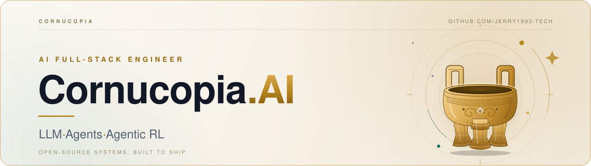

  <picture>
    <source media="(prefers-color-scheme: dark)" srcset="assets/banner-dark-ding.svg">
    <source media="(prefers-color-scheme: light)" srcset="assets/banner-light-ding.svg">
    
  </picture>

  
  
  
  

  Building open-source LLM & agent systems — from post-training to production.

## About

I'm an **AI Full-Stack Engineer** working across the LLM stack: post-training, agents, retrieval, and the engineering that puts them into production. I build in the open and care about systems that hold up outside the demo.

- **Building** [Cornucopia](https://github.com/jerry1993-tech/Cornucopia-LLaMA-Fin-Chinese) — an open-source Chinese financial LLM series and a lightweight vertical-domain training stack (pretraining → SFT → RLHF → quantization).
- **Exploring** agentic RL with GRPO, multi-turn tool use, sandboxed execution, and execution-verified rewards.
- **Designing** production-grade multi-agent architectures, collaboration patterns, and workflow engines.
- **Based in Norway** · open to collaboration and AI engineering opportunities.

## Focus

| Area | Work |
| :-- | :-- |
| **Agentic RL & Post-Training** | GRPO, multi-turn tool use, sandboxed execution, and execution-verified rewards. |
| **Multi-Agent Systems** | Orchestration, collaboration patterns, tool routing, and workflow engines. |
| **Vertical-Domain LLMs** | Financial LLMs in Chinese, from pretraining and SFT through RLHF and quantization. |
| **Applied NLP & Retrieval** | BERT-family models, semantic matching, distillation, prompt learning, and Faiss retrieval. |

## Selected Work

### Flagship

- [**Cornucopia-LLaMA-Fin-Chinese**](https://github.com/jerry1993-tech/Cornucopia-LLaMA-Fin-Chinese)   — An open-source Chinese financial LLM series with a lightweight vertical-domain training framework covering pretraining, SFT, RLHF, and quantization.

### Agent Systems

- [**Cornucopia-Multi-Agent**](https://github.com/jerry1993-tech/Cornucopia-Multi-Agent)  — Production-grade multi-agent orchestration: 6 collaboration modes, 8 specialized tools, and 4 execution paths, built with FastAPI and Streamlit.
- [**mimo-agent-grpo-swift**](https://github.com/jerry1993-tech/mimo-agent-grpo-swift)  — End-to-end reproduction of MiMo-V2.6's interactive Agent RL pipeline on MS-Swift: multi-turn tool use, sandboxed execution, real-execution verification, and GRPO.
- [**aligo-travel-agents**](https://github.com/jerry1993-tech/aligo-travel-agents)  — Enterprise-grade multi-agent travel assistant built from scratch on AgentScope 2.0.

### NLP Foundations

- [**xbert**](https://github.com/jerry1993-tech/xbert)  — TensorFlow 2.x architecture for loading BERT and its variants.
- [**Semantic-Similarity-Match**](https://github.com/jerry1993-tech/Semantic-Similarity-Match)  — TensorFlow 2.x toolkit for text similarity, knowledge distillation, interaction models, and dual-tower SBERT.
- [**NLP-Prompt**](https://github.com/jerry1993-tech/NLP-Prompt)  — Prompt-learning algorithms for NLP tasks including text classification and information extraction.

<b>More open-source work</b>

 

- [**Agentic-AI-Knowledge**](https://github.com/jerry1993-tech/Agentic-AI-Knowledge) — Working notes on LangGraph, LightRAG, Milvus, Neo4j, Claude Agent SDK, and multi-agent architecture.
- [**Faiss-FAQ_roboat**](https://github.com/jerry1993-tech/Faiss-FAQ_roboat) — Applying Faiss to FAQ retrieval and question answering.
- [**Text-CLS**](https://github.com/jerry1993-tech/Text-CLS) — TensorFlow 2.x text classification with adversarial training, label smoothing, and class-imbalance handling.
- [**Entity-Extraction**](https://github.com/jerry1993-tech/Entity-Extraction) — Entity extraction with PyTorch / TensorFlow 2.x.
- [**Property-Graph-by-python3.5**](https://github.com/jerry1993-tech/Property-Graph-by-python3.5) — A property graph implementation in Python.

## Stack

**LLM & Training**  

  
  
  
  
  
  

**Agents & Retrieval**  

  
  
  
  
  
  

**Engineering**  

  
  
  
  
  

## GitHub

  <picture>
    <source media="(prefers-color-scheme: dark)" srcset="https://github-readme-stats.vercel.app/api?username=jerry1993-tech&show_icons=true&hide_title=true&hide_border=true&rank_icon=github&title_color=D4A24C&icon_color=D4A24C&text_color=9CA3AF&bg_color=0B1220">
    
  </picture>
  <picture>
    <source media="(prefers-color-scheme: dark)" srcset="https://github-readme-stats.vercel.app/api/top-langs/?username=jerry1993-tech&layout=compact&langs_count=4&hide_title=true&hide_border=true&title_color=D4A24C&text_color=9CA3AF&bg_color=0B1220">
    
  </picture>

  <picture>
    <source media="(prefers-color-scheme: dark)" srcset="https://raw.githubusercontent.com/jerry1993-tech/jerry1993-tech/output/snake-dark.svg">
    <source media="(prefers-color-scheme: light)" srcset="https://raw.githubusercontent.com/jerry1993-tech/jerry1993-tech/output/snake.svg">
    
  </picture>

## Open to collaborate

If you're working on LLM agents, post-training, or vertical-domain models, I'd be glad to compare notes.

  

Thanks for stopping by.

